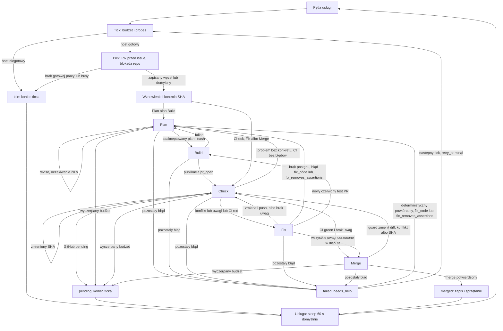

# Maszyna stanów lokay2

## Rewizje i zakres dowodu

Analizowany kod: **`594334bd391da5958153d864b972a869cdecf565`** (HEAD przed zmianą dokumentacji).
Historia opisana w #1816: **`f343c0845efe7bdc2a34a0b3df6ab0fe8cc93b33`**.
Oba obiekty są dostępne lokalnie: `git rev-parse HEAD` oraz `git rev-parse --verify 'f343c08^{commit}'`.
`git ls-tree --name-only HEAD STATE_MACHINE.md RISKS.md INCIDENTS.md` nie zwrócił plików.

Opis „13.10” pochodzi z przekazanej treści [#1816](https://github.com/mikolaj92/lokay/issues/1816).
Nie ustala roku ani czasu wdrożenia. Issue jest relacją do sprawdzenia, nie instrukcją runtime.
Aktualne zachowanie poniżej oznacza zachowanie analizowanego SHA, nie potwierdzony stan hostów.
Odnośniki źródłowe wskazują ten SHA. Dawne numery linii nie są dowodem aktualnego kodu.
Rejestr ryzyk: [RISKS.md](RISKS.md). Weryfikacja incydentów: [INCIDENTS.md](INCIDENTS.md).

## Warstwy

`Plan`, `Build`, `Check`, `Fix`, `Merge` są zapisanymi węzłami grafu.
`idle`, `failed`, `pending`, `pr_open`, `check`, `merged` są wynikami operacji lub ticka.
Tick oznacza jedno wywołanie `lokay start`. Backoff oznacza czasową niedostępność pracy, nie szósty węzeł.
`needs_help()` zapisuje retry albo re-Plan. Nie przekazuje pracy człowiekowi.[S1][S3]

Diagram grupuje przygotowanie i wznowienie. Wznowienie Merge zawsze wymusza świeży Check;
Fix zachowuje uwagi tylko dla zgodnego SHA. Zaakceptowany Build może pominąć pisanie Planu.[S3][S4]
Strzałka Retry → Plan opisuje zapis węzła dla następnego wywołania, nie obowiązkowo wykonanie w tym ticku.[S3]
Każda strzałka warunkowa ma rozwinięcie w tabelach poniżej.

## Wybór pracy i granice ticka

| Stan / punkt | Warunek | Działanie | Zapis stanu | Następny stan / wynik | Źródło |
| --- | --- | --- | --- | --- | --- |
| Usługa | zwykła iteracja | self-update, potem start; sleep po zakończeniu | wersja z wyniku update | następny Tick | [S9][S10] |
| Usługa | update udany i updated | exec nowego skryptu | LOKAY_VERSION | nowa pętla | [S9] |
| Usługa | brak executable, błąd logu, niedozwolony canary repo | exit 69, 73 lub 64 | brak stanu grafu | koniec procesu usługi | [S9] |
| Usługa | `--once` | exit z kodem start / canary | brak nowego node | koniec procesu | [S9] |
| Tick | nieważny budżet | ValueError przed pick | brak | błąd procesu | [S8][S2] |
| Pick | którykolwiek probe ≠ ok | brak wyboru | obserwacja idle_reason=host_down | idle, exit 0 | [S1][S2] |
| Pick PR | host gotowy | repo według najstarszego repo_attempt, potem nazwy; PR `lokay/N` według last_attempt, potem numeru | repo_attempt pod lockiem | kandydat PR | [S1][S12] |
| Pick PR | retry_at > teraz | odłożenie kandydata | bez zmiany jego node | szukanie gotowego PR | [S1] |
| Pick PR | lock busy | repo pomijane w tej próbie; PR wykryty przed lockiem | blocked w pamięci | inne repo albo idle | [S1][S13] |
| Pick PR | gotowy PR i held | odtworzenie znanego node, inaczej check | running, node, branch, pr, last_attempt | Plan/Build albo resume | [S1] |
| Pick issue | nie wybrano PR, lecz istnieje otwarty PR lokay | nie bierze nowych issue, także przy backoff/busy lub filtrze issue | obserwacja idle | idle_backoff albo no_work | [S1] |
| Pick issue | brak otwartych PR lokay | najstarsze createdAt, potem numer; pierwszy gotowy task bez PR | running, node zapisany albo plan, branch, pr=None | Plan/Build | [S1][S6] |
| Pick issue | epic/tracker w tytule lub etykiecie, albo lokay-stalled | wykluczenie nowego issue | brak | inny kandydat | [S1] |
| Pick | brak wyboru | idle; blocked wybiera rekord z największym failures | idle_reason, dostępne failures/last_error/issue_since w obserwacji | exit 0 | [S1][S2] |
| Tick | deadline w pick | main łapie TickExpired | brak gwarantowanego pending wybranego issue | exit 0 | [S2] |
| Węzeł | deadline w guarded_step | zapis pending i rounds | node zostaje; result=pending, reason | koniec ticka | [S1][S7] |
| Tick | wybrano pracę | advance albo resume | według węzłów poniżej | release w finally, exit 0 | [S2][S13] |

Probes sprawdzają Decision HTTP, provider, model, konfigurację Decision, dostępność pi i `gh auth status`.
Nie dowodzą możliwości merge ani wykonania testów.[S1]
Blokada jest nieblokującym `flock` per repo. Właściciel ticka zwalnia ją także po wyjątku.[S2][S13]
LaunchAgent ma KeepAlive i ThrottleInterval=60, ale sama pętla śpi **po** pracy.
Nie jest to start co 60 sekund niezależnie od czasu ticka.[S9][S14]

## Przejścia grafu

| Stan | Warunek | Działanie | Zapis stanu | Następny stan / wynik | Źródło |
| --- | --- | --- | --- | --- | --- |
| Plan/Build | brak poprawnego planu, hash akceptacji niezgodny, node=plan lub plan_phase | wznowienie fazy write/check | plan_prompt, plan_phase, plan_rounds, plan_evaluations | Plan | [S3] |
| Plan | zapis ≠ done albo plan bez wymaganych sekcji | _retry → needs_help | failures, reason, retry_at | failed, koniec ticka | [S2][S3][S5] |
| Plan | kryterium p(true) < 0.35 | revise; prompt z historią; retry_sleep(20) | fingerprint, history, phase=write | Plan w tym ticku do deadline | [S3][S5] |
| Plan | brak kryteriów < 0.35 | akceptacja; p od 0.35 do <0.5 to notes | node=build, plan_accepted_sha, notes; phase/prompt=None | Build | [S3][S5] |
| Build | brak worktree | worktree_add; setup zależności | node=build | Build albo błąd retry | [S3][S17] |
| Build | build_code failed | świeży prompt z błędem i historią | node=plan, phase=write, failures+1, retry_at=0, hash=None | next=plan; koniec ticka | [S3][S11] |
| Build | otwarty PR i brak h2_start | restart z treści origin/<base>, z rodzicami HEAD i origin/<base>; pusty patch wymaga pełnego wykonania, podsumowania i zielonego main | h2_start; pusty patch zamyka PR i issue z dowodami, zachowuje branch | Build albo closed | [S3] |
| Build | done | push i stworzenie/odnalezienie PR; wymagany published SHA | failures=0, sha, pr, node=check, verdict=None | Check w tym ticku | [S3][S11] |
| Build | publikacja ≠ pr_open lub brak SHA | retry | failures, reason, retry_at | failed | [S2][S3] |
| Resume | brak PR/SHA, zły numer/branch, błąd Git | needs_help | błąd i retry | failed | [S4] |
| Resume | worktree brak lub zły branch | zachowanie starego worktree pod nazwą recovery; odtworzenie z remote | node=check, verdict/local_ci=None | Check | [S4] |
| Resume | lokalny HEAD różny od PR SHA | fetch, ff/merge lub push lokalnych commitów; weryfikacja PR po push | nowy sha; opis PR | Check albo needs_help | [S4] |
| Resume | zapisany SHA/verdict niezgodny | unieważnienie verdict/fingerprint | node=check | Check | [S4] |
| Resume Merge | nawet przy zgodnym SHA | wymuszenie Check w nowym ticku | pending w pamięci=check | Check | [S4] |
| Check | merge main daje konflikt | uwagi dla konfliktowych plików | node=fix, verdict SHA-bound | Fix w tym ticku | [S4] |
| Check | main zsynchronizowany, publish remote_moved | sync_head, nowy SHA | przez kolejną iterację | Check | [S4][S17] |
| Check | GitHub SHA ≠ kandydat | sync_head | nowy SHA w kolejnej iteracji | Check | [S4][S6] |
| Check | GitHub ma pending (także razem z red) | komentarz pending, zakończenie | node=check, result=pending, verdict=None | pending, koniec ticka | [S4][S6] |
| Check | setup/test nieudany, nie uruchomiono skonfigurowanych testów, pominięto zmieniony pakiet albo GitHub red | aggregate uwag checks; przy fix bez zlokalizowanych uwag log trafia do uwagi i unlocated_findings; scope może dodać uwagę | local_ci, tested, verdict, check_history | Fix | [S4][S15] |
| Check | uwagi lensów albo scope | aggregate, zapis komentarza i opisu PR | verdict SHA-bound; deleted_files: replan z uwagami i PLAN_RESET | deleted_files → Plan, pozostałe → Fix | [S4][S15][S16] |
| Check | problem bez konkretu, brak błędów/uwag blokujących | replan_prompt; _prepare | node=plan, phase=write, hash=None | Plan w tym ticku | [S4][S15] |
| Check | local_ci green, GitHub green/no_ci, brak uwag/replan | aggregate merge | node=merge, verdict SHA-bound | Merge | [S4][S6][S15] |
| Fix | uwagi puste | unieważnienie cache/fingerprint | node=check, result=check | check, koniec ticka | [S4] |
| Fix | diff bez zmiany, fingerprint+hunk bez zmiany albo liczba uwag nie maleje w trzech rundach; brak możliwości dispute | fix_to_build albo świeży Plan z historią | counts/history; node=build albo plan | Build jako next, albo Plan w ticku | [S4] |
| Fix → Build | local_ci red dla aktualnego HEAD; FAILED wskazuje jednoznacznie nowy plik testu PR | build_note z logiem | node=build, failures=0, retry_at=0 | next=build, koniec ticka | [S3][S4] |
| Fix | pusty patch harness2 albo HEAD bez zmiany po commit | done z no_changes; publikacja bez zmiany SHA i fix_complete | pi_response; rounds; pierwszy raz SHA w dispute_rechecks, node=check; ponownie ten sam SHA: node=plan, PLAN_RESET | Check albo Plan | [S4] |
| Fix | outside_worktree | świeży Plan z wyjaśnieniem | node=plan, phase=write, hash=None, retry_at=0 | next=plan | [S3][S4] |
| Fix | fix_code ≠ done, wyjątek lub patch usuwa więcej asercji niż dodaje w pliku testowym | needs_help; fix_code lub fix_removes_assertions prowadzi do Plan; odrzucony patch jest cofany do HEAD | failures/reason; możliwy prompt Plan | failed, koniec ticka | [S3][S4] |
| Fix | done i publish pushed/remote_moved | sync remote gdy potrzebne, kontrola SHA po pushed, opis PR | sha, fingerprint/hunk/diff, node=check, verdict=None | Check w ticku | [S4] |
| Fix | publish błąd albo PR nie potwierdza push SHA | needs_help | failures, reason, retry_at | failed | [S3][S4] |
| Merge | PR SHA niezgodny lub wynik merge ≠ merged | sync przy nowym SHA; sleep 60 poza conflict | node=check, verdict=None | Check w ticku | [S4][S19] |
| Merge | verdict=merge i SHA zgodny; gh potwierdza merge | zapis merged przed usunięciem worktree | merged, failures=0, retry_at=0; obserwacja last_merge | merged, koniec ticka | [S1][S4][S19] |
| Merge | sprzątanie worktree po merge | atomowe przeniesienie do ukrytego katalogu, prune rejestracji, kasowanie; błąd kasowania nie blokuje usunięcia, inny błąd daje warning | merged zachowany | merged | [S19] |
| Dowolny krok | zwykły wyjątek / nieoczekiwany wynik | guarded_step/_retry/fix_step → needs_help | patrz tabela retry | failed | [S1][S2][S3] |

### Retry, trwałość i granice

| Warunek needs_help | Zapis / działanie | Wznowienie | Źródło |
| --- | --- | --- | --- |
| reason pasuje do timeout/network/connection/HTTP 5xx/host probe | failures+1; `min(3600, 60 × 2^min(failures−1, 6))` sekund; zachowany node | Pick po retry_at | [S3] |
| błąd nietransientny, niepowtórzony, nie fix_code i bez fix_removes_assertions | failures+1, retry_at=0, zachowany node i last_error | dla PR w Check/Fix/Merge: kolejny tick po ≥300 s od ostatniej aktywności | [S3] |
| nietransientny i powtórzony, zaczyna się fix_code albo zawiera fix_removes_assertions | node=plan, prompt z dowodami, hash=None, last_error=None, retry_at=0 | Plan w kolejnym ticku | [S3] |
| _retry sukces | failures=0, retry_at=0, reason=None | kontynuacja tego ticka | [S2] |

Stan JSON zastępuje plik przez plik tymczasowy. Rounds są dopisywane osobno.
Nie jest to transakcja obejmująca Git, GitHub, stan i logi.[S12]
Budżet domyślny to 2700 s. Deadline zaczyna się przed wyborem pracy.
Poza harness2 proces ma limit minimum z timeout operacji, 3600 s i pozostałego budżetu; harness2 Build/Fix nie podlega deadline ticka, ale zachowuje timeout każdego procesu do 3600 s; sprzątanie procesu ma dodatkowe 5 s.[S2][S7][S8]
Nie ma limitu liczby rund. Jest limit czasu rozpoczynania operacji i oczekiwania na procesy.
Operacje plikowe i sprzątanie guardów nie mają twardego wspólnego limitu czasu.[S7]

`test: []` daje local green z tested=false i notatką. Brak GitHub checks daje no_ci, nie green; anulowany CheckRun jest pomijany tylko przy nieanulowanym CheckRun z tym samym workflowName i name.
Oba wyniki mogą dopuścić Merge przy braku uwag. To świadoma granica dowodu w tej implementacji,
nie dowód wykonania testów lub sukcesu wymaganych kontroli.[S6][S15]
Review jest osobny na lens, ale może mieć wiele partii i follow-upów. Hunki są ograniczone do 1500 znaków na plik.
Próg binarny to 0.85; follow-up wymaga zwycięskiego pliku z p ≥ 2 × p(none).
Co najmniej pięć identycznych wskazań różnych kategorii trafia do notes zamiast blokowania.
Dispute może odrzucić uwagę dla tego SHA. Te mechanizmy nie dowodzą braku błędów.[S4][S15]

## Różnice względem relacji „13.10”

Porównanie opiera się na `git diff f343c08 HEAD -- src/lokay scripts repos.yaml questions`.
Historyczny [start.py][H1] ma wymienione w issue numery linii; nie przenosimy ich do aktualnych odnośników.

| Relacja historyczna | Analizowana rewizja | Dowód |
| --- | --- | --- |
| tick bez budżetu, sleep bez deadline | budżet, kill grup procesów, resume fazy Planu | [S2][S3][S7][H1] |
| wybór repo w kolejności konfiguracji | najstarszy repo_attempt, ale globalny priorytet PR pozostaje | [S1][S12][H1] |
| fingerprint oparty o linie; re-Plan bez historii | fingerprint findings bez linii, hunk/diff i counts; historia w prompt | [S3][S4][H1] |
| każdy needs_help robi backoff | backoff tylko dla błędów pasujących do regexu transient | [S3][H1] |
| lensy razem, bez hunków; próg absolutny follow-up | lensy osobno, partie z hunkami, próg względny; dispute | [S4][S15] |
| scope z tytułu | diff wobec sekcji Pliki; wyjątki test/lockfile; uwaga disputable | [S16][S4] |
| brak checks równy green | osobny no_ci, nadal dopuszczony; did_run i kontrola pakietów | [S6][S15][S4] |
| git add -A wszystko | snapshot przed pi i wybór ścieżek; resume bez snapshotu nadal może commitować zastany stan | [S11][S4] |
| skip-issues.json i epic | brak skip-file; nowe epic/tracker/alarm odfiltrowane, otwarte PR nie | [S1][H1] |
| cleanup po merge może dać failed | cleanup warning po trwałym merged; błąd wcześniejszego zapisu nadal możliwy | [S19] |

## Kontrole tej zmiany

- Bramka: `bash scripts/check.sh`; inwentarz **37 scenariuszy** według [S20].
- Pierwsza próba zatrzymała się na build przed wykonaniem scenariusza: odziedziczony pushurl `no_push://disabled` blokował Git fixture.
- Powtórka z `GIT_CONFIG_COUNT=0` i cache/TMPDIR wewnątrz checkoutu zatrzymała się w build:
  `sandbox-exec: sandbox_apply: Operation not permitted` (build_code zwrócił pi_exit).
- Wynik: **uruchomione=1/37, ukończone=0/37; errors=0 nie uzyskano**. Nie zmieniono sandboxu ani testów dla obejścia hosta.
- W drzewie analizowanego SHA brak `.github/workflows`. Publiczne API `rules/branches/main` zwróciło HTTP 200 i `[]`.
  To nie potwierdza braku klasycznej ochrony branch ani wszystkich wymaganych kontroli.
- Publiczne API klasycznej ochrony `branches/main/protection` zwróciło HTTP 401; wymagania ochrony są niepotwierdzone.
- Publiczne API PR dla `head=mikolaj92:lokay/1816` zwróciło HTTP 200 i `[]`.
  Nie znaleziono PR, więc wymagane checks dla końcowego SHA są **niepotwierdzone**.
- Mermaid: składnia sprawdzona przez `mermaid.parse` (Mermaid z DOM jsdom, narzędzia tylko w ignorowanym `.uv/`).
  Sprawdzono lokalne cele odnośników, definicje źródeł, zakresy linii i komplet R1–R25.
  Odnośniki kodu odpowiadają obiektom Git; nie sprawdzono dostępności każdej strony przez HTTP.
- Końcowy SHA dokumentacji poda raport commita. Jest inny niż SHA analizowanego kodu.
  Brak push i kontroli PR nie jest sukcesem odbioru.

## Źródła kodu (przypięte)

[S1]: https://github.com/mikolaj92/lokay/blob/594334bd391da5958153d864b972a869cdecf565/src/lokay/start.py#L19-L228
[S2]: https://github.com/mikolaj92/lokay/blob/594334bd391da5958153d864b972a869cdecf565/src/lokay/start.py#L254-L324
[S3]: https://github.com/mikolaj92/lokay/blob/594334bd391da5958153d864b972a869cdecf565/src/lokay/start.py#L327-L621
[S4]: https://github.com/mikolaj92/lokay/blob/594334bd391da5958153d864b972a869cdecf565/src/lokay/start.py#L622-L1228
[S5]: https://github.com/mikolaj92/lokay/blob/594334bd391da5958153d864b972a869cdecf565/src/lokay/plan.py
[S6]: https://github.com/mikolaj92/lokay/blob/594334bd391da5958153d864b972a869cdecf565/src/lokay/gh.py
[S7]: https://github.com/mikolaj92/lokay/blob/594334bd391da5958153d864b972a869cdecf565/src/lokay/run.py
[S8]: https://github.com/mikolaj92/lokay/blob/594334bd391da5958153d864b972a869cdecf565/src/lokay/config.py
[S9]: https://github.com/mikolaj92/lokay/blob/594334bd391da5958153d864b972a869cdecf565/scripts/lokay-service.sh
[S10]: https://github.com/mikolaj92/lokay/blob/594334bd391da5958153d864b972a869cdecf565/scripts/self_update.sh
[S11]: https://github.com/mikolaj92/lokay/blob/594334bd391da5958153d864b972a869cdecf565/src/lokay/build.py
[S12]: https://github.com/mikolaj92/lokay/blob/594334bd391da5958153d864b972a869cdecf565/src/lokay/state.py
[S13]: https://github.com/mikolaj92/lokay/blob/594334bd391da5958153d864b972a869cdecf565/src/lokay/lock.py
[S14]: https://github.com/mikolaj92/lokay/blob/594334bd391da5958153d864b972a869cdecf565/scripts/ai.mikolaj.lokay2.plist
[S15]: https://github.com/mikolaj92/lokay/blob/594334bd391da5958153d864b972a869cdecf565/src/lokay/check.py
[S16]: https://github.com/mikolaj92/lokay/blob/594334bd391da5958153d864b972a869cdecf565/src/lokay/scope.py
[S17]: https://github.com/mikolaj92/lokay/blob/594334bd391da5958153d864b972a869cdecf565/src/lokay/git.py
[S19]: https://github.com/mikolaj92/lokay/blob/594334bd391da5958153d864b972a869cdecf565/src/lokay/merge.py
[S20]: https://github.com/mikolaj92/lokay/blob/594334bd391da5958153d864b972a869cdecf565/scripts/check.sh
[H1]: https://github.com/mikolaj92/lokay/blob/f343c0845efe7bdc2a34a0b3df6ab0fe8cc93b33/src/lokay/start.py
